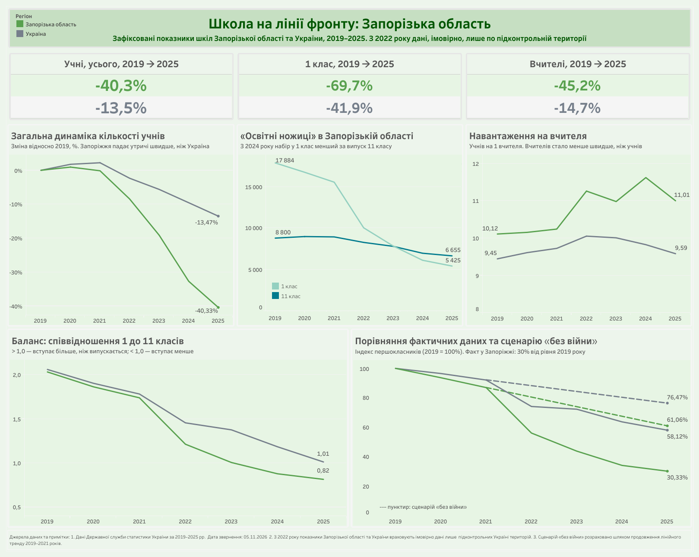
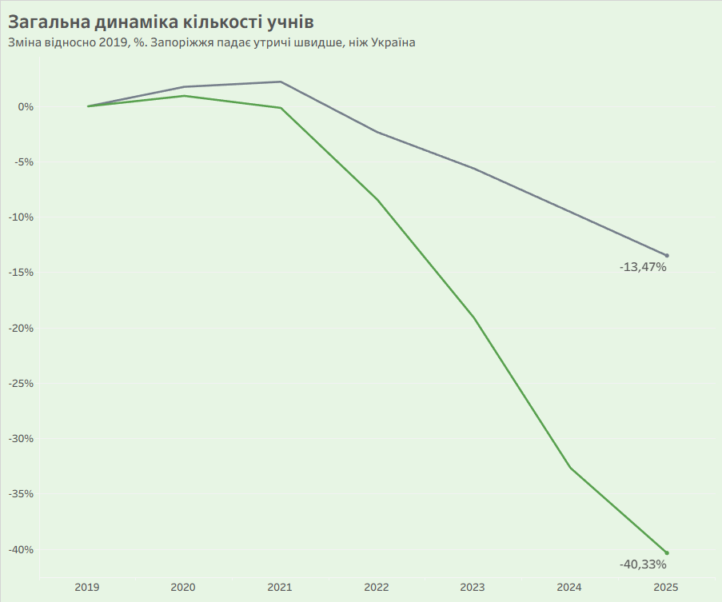
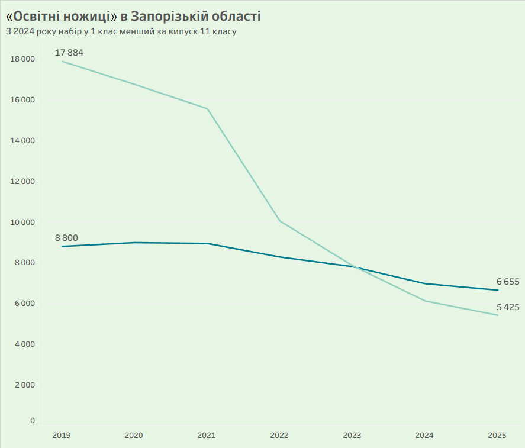
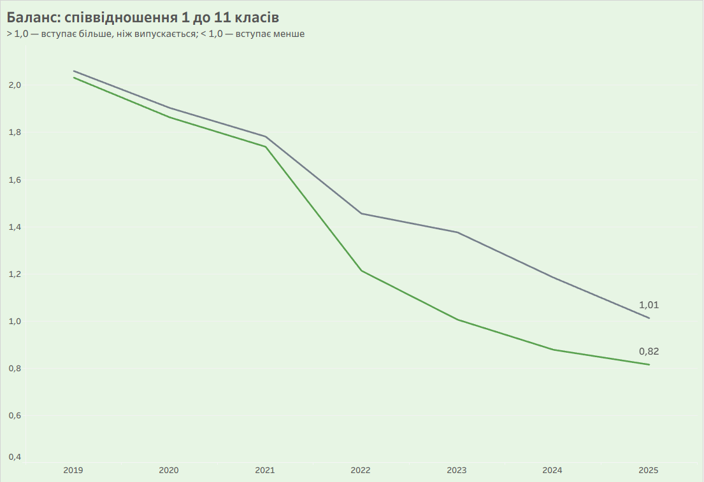
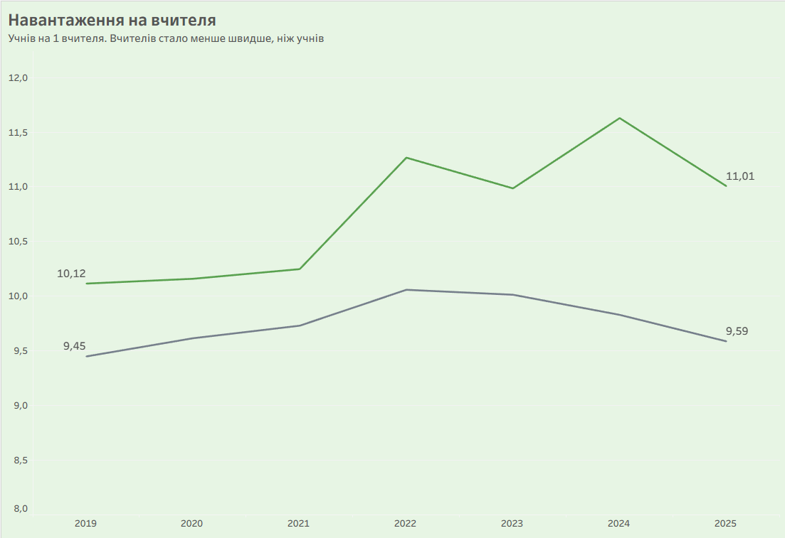
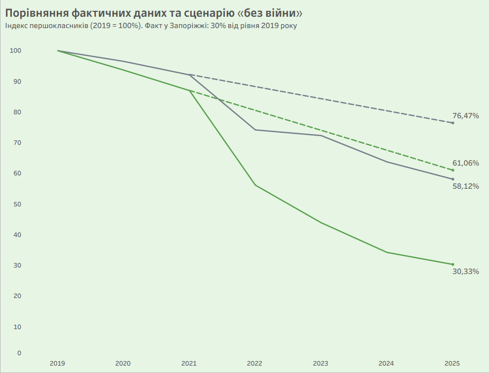

# Освіта в Запорізькій області на тлі України, 2019–2025: що показують дані до і після 2022 року

**Ключові слова:** освіта, загальна середня освіта, Запорізька область, прифронтовий регіон, війна, кількість учнів, освітні ножиці, баланс 1 до 11 класу, навантаження на вчителя, Держстат, аналіз відкритих даних, Tableau.

Повномасштабна війна змінила шкільну освіту по всій Україні, але не однаково. У прифронтових регіонах поєднуються кілька чинників: переміщення населення, закриття закладів, втрата вчителів і окупація частини територій. У цьому дослідженні на відкритих даних Держстату порівнюється динаміка шкільної освіти **Запорізької області** та **України загалом** за 2019–2025 роки.

**Важлива особливість даних.** Після 2022 року Держстат наводить багато показників по області без урахування тимчасово окупованих територій та частини територій, на яких ведуться (велися) бойові дії. Тому зміна показника поєднує дві речі: реальну динаміку на підконтрольній території та зменшення території, яку охоплює статистика. Це визначає, як слід читати результати.

**Головне питання:** як змінилися зафіксовані показники шкільної освіти в Запорізькій області порівняно з Україною і які з них найменше залежать від зміни території охоплення, а отже, найкраще показують структурні зміни?

**Мета:** виміряти зміни в кількості учнів, учителів і закладів, відокремити абсолютні показники (чутливі до зміни охоплення) від відносних (баланс, навантаження) та сформулювати рекомендації для планування освітньої мережі та збору даних.

---

## 📊 Інтерактивний дашборд
🔗 [Переглянути інтерактивний дашборд на Tableau Public](https://public.tableau.com/views/_17941695242390/sheet9?:language=en-US&publish=yes&:sid=&:display_count=n&:origin=viz_share_link)

<p align="center">
  
</p>

---

## Короткий підсумок

- Зафіксована кількість учнів у Запорізькій області за 2019–2025 роки зменшилася на **40,3%**, в Україні на **13,5%**; перших класів стало менше на **69,7%** проти **41,9%**.
- Частина цього падіння пояснюється тим, що з 2022 року окуповані території, імовірно, випали зі статистики, тому абсолютні числа слід читати обережно.
- Відносні показники менше залежать від охоплення: баланс 1 / 11 клас у Запорізькій області нижче одиниці з 2024 року (0,82 у 2025), а навантаження на вчителя зросло з 10,1 до 11,0 учня.
- Спад розпочався ще до 2022 року (кількість першокласників скорочувалася вже у 2019–2021), а війна та пов'язані з нею чинники його прискорили.

---

## Основна методологія

**Дані.** Відкритий набір Держстату про заклади загальної середньої освіти (DF_EDUCATIONAL_INSTITUTIONS), річна періодичність, роки 2019–2025. Оригінальний файл містить 28 територіальних розрізів та десятки показників. Для аналізу відібрано два розрізи (Запорізька область, Україна) і такі показники:

- кількість учнів: усього, а також 1, 5, 9 та 11 клас;
- кількість вчителів;
- кількість закладів загальної середньої освіти.

**Застосовані підходи:**

- аналіз часових рядів (динаміка за роками);
- порівняння темпів змін відносно 2019 року (першого року ряду); у таблиці ключових показників додатково наведено 2021 рік як останній рік до повномасштабного вторгнення;
- порівняння регіону із загальноукраїнським рівнем;
- розподіл показників на **абсолютні** (кількість учнів, закладів, вчителів; чутливі до зміни території охоплення) та **відносні** (баланс «1 клас / 11 клас», учнів на вчителя; менш чутливі до цієї зміни, хоча не повністю);
- умовний сценарій «без війни»: лінійний тренд 2019–2021, продовжений до 2025 року (для учнів 1 класу; значення подано як індекс, 2019 = 100).

**Територіальне охоплення.** У примітках Головного управління статистики у Запорізькій області до виданих матеріалів за 2022–2023 роки та до щомісячних випусків 2026 року зазначено, що дані наведено без урахування тимчасово окупованих територій та частини територій, де ведуться (велися) бойові дії. У самому файлі набору поле приміток порожнє, тому застосування цього правила саме до даних про освіту слід вважати обґрунтованим припущенням, яке потребує підтвердження в Держстаті.

**Підготовка даних.** Дані відібрано та перетворено засобами SQL у DBeaver (скрипт у папці `sql`): відфільтровано потрібні показники й розрізи, роки зі стовпців перетворено на рядки. Результат містить 98 рядків фактичних даних (2 регіони × 7 показників × 7 років) у файлі `data/zaporizhzhia_edu.csv`. Сценарій «без війни» розраховано в Tableau за лінійним трендом 2019–2021 років. Графіки та розрахункові показники побудовано в Tableau Public.

**Перевірка якості.** У вихідних даних для показників «усього» є по три рядки: «Загалом», «Міська» та «Сільська» місцевість. Якщо їх не розділити, підсумки зростуть утричі, тому для загальних показників використано лише «Загалом». У вибірці немає дублів і пропущених значень, а підсумки звірено з вихідним файлом.

---

## Ключові показники

| Показник | Запоріжжя 2019 | 2021 | 2025 | Зміна 2019→2025 | Зміна 2021→2025 |
|---|---|---|---|---|---|
| Учні, усього | 170 621 | 170 381 | 101 816 | -40,3% | -40,2% |
| Учні, 1 клас | 17 884 | 15 559 | 5 425 | -69,7% | -65,1% |
| Учні, 11 клас | 8 800 | 8 946 | 6 655 | -24,4% | -25,6% |
| Вчителі | 16 867 | 16 626 | 9 250 | -45,2% | -44,4% |
| Заклади | 538 | 496 | 294 | -45,4% | -40,7% |

| Показник | Україна 2019 | 2021 | 2025 | Зміна 2019→2025 | Зміна 2021→2025 |
|---|---|---|---|---|---|
| Учні, усього | 4 138 466 | 4 230 358 | 3 580 842 | -13,5% | -15,4% |
| Учні, 1 клас | 434 484 | 400 173 | 252 517 | -41,9% | -36,9% |
| Учні, 11 клас | 210 863 | 224 521 | 249 444 | +18,3% | +11,1% |
| Вчителі | 437 961 | 434 755 | 373 488 | -14,7% | -14,1% |
| Заклади | 15 194 | 13 991 | 11 820 | -22,2% | -15,5% |

Ці числа слід читати обережно: у Запорізькій області їх суттєво формує виключення окупованих територій зі статистики, тому вони не дорівнюють «втраті освіти» на підконтрольній території. Особливий випадок 11 клас: у Запоріжжі він скоротився, а в Україні **зріс** (+18,3% до 2019 року). Причини цього зростання з наявних даних встановити не можна.

---

## Результати

### 1. Загальна динаміка кількості учнів

<p align="center">
  
</p>

Графік показує зміну кількості учнів відносно 2019 року. До 2021 року обидві лінії залишаються поблизу нуля: у Запорізькій області -0,1%, в Україні +2,2% у 2021 році. Після 2021 року траєкторії розійшлися: до 2025 року кількість учнів у Запорізькій області зменшилася на **40,3%**, в Україні на **13,5%**. Найшвидше показник у Запоріжжі зменшувався у 2023–2024 роках: до -19,1% у 2023 році та -32,6% у 2024.

### 2. «Освітні ножиці»: першокласники та одинадцятикласники

<p align="center">
  
</p>

У 2019 році в Запорізькій області було 17 884 першокласники й 8 800 одинадцятикласників. До 2025 року перших класів стало 5 425, а одинадцятих 6 655. Лінії перетнулися у 2023–2024 роках: з 2024 року учнів у 1 класі менше, ніж у випускному. Це означає, що система стискається знизу, і цей ефект поширюватиметься на старші класи в наступні роки.

### 3. Баланс 1 / 11 клас

<p align="center">
  
</p>

Показник відображає, скільки першокласників припадає на одного учня 11 класу. Оскільки це відношення двох величин, воно значно менше залежить від зміни території охоплення, ніж абсолютні числа. У 2019 році він був майже однаковим: 2,03 у Запоріжжі та 2,06 в Україні. У Запорізькій області він опустився нижче одиниці у 2024 році (0,88) і складає 0,82 у 2025 році. В Україні він дійшов до 1,01. Значення нижче одиниці означає, що вступає менше учнів, ніж випускається.

### 4. Навантаження на вчителя

<p align="center">
  
</p>

У Запорізькій області кількість учнів на одного вчителя зросла з 10,1 у 2021 році до 11,0 у 2025 (з піком 11,6 у 2024 році). В Україні показник майже не змінився: 9,4 у 2019 та 9,6 у 2025. Тобто вчителів у Запоріжжі стало менше швидше, ніж учнів, і навантаження зросло.

### 5. Умовний сценарій «без війни»

<p align="center">
  
</p>

Щоб оцінити масштаб змін, лінійний тренд 2019–2021 років (до повномасштабного вторгнення) продовжено на 2022–2025 роки. Результат показано як індекс кількості першокласників (2019 = 100). У Запорізькій області фактичне значення 2025 року становить 30,3% від рівня 2019 року, тоді як за сценарієм воно мало б бути близько 61,1%; в абсолютних числах це 5 425 проти приблизно 10 920 першокласників, тобто приблизно на 50% менше. В Україні фактичне значення 58,1%, сценарне близько 76,5% (252 517 проти приблизно 332 242, приблизно на 24% менше). Лінія сценарію теж спадає, бо кількість першокласників скорочувалася ще до повномасштабного вторгнення: у 2019–2021 роках на 13,0% у Запорізькій області й на 7,9% в Україні. Імовірною причиною є демографічна динаміка, проте ці дані цього не доводять. Тобто частина спаду не пов'язана з війною, а після 2021 року він різко прискорився. Це спрощена ілюстрація, а не прогноз: різниця між фактом і сценарієм включає і зменшення території охоплення, і демографічну динаміку.

---

## Обмеження й застереження

- **Дані показують що зафіксовано, а не чому.** Динаміка після 2021 року збігається в часі з повномасштабною війною, але причинно-наслідковий зв'язок цими даними не доводиться. На показники одночасно впливають переміщення населення, окупація територій, демографічна динаміка та зміни в організації мережі.
- **Територіальне охоплення змінюється в часі.** Після 2022 року дані по Запорізькій області не охоплюють тимчасово окуповані території та частину територій, де ведуться бойові дії (так зазначено в методологічних примітках Держстату до матеріалів по області). Тому абсолютні числа в різні роки описують різну територію. Це стосується й даних по Україні загалом, тож порівняння «Запоріжжя проти України» не є повністю однорідним.
- **Відносні показники менш чутливі, але не імунні.** Баланс 1/11 та навантаження менше залежать від розміру території, проте можуть відрізнятися за структурою між підконтрольною і окупованою частинами.
- **Рівень даних: область, а не місто.** Набір містить лише територіальні розрізи за областями (Запорізька область) і Україну в цілому; окремих даних по місту Запоріжжя чи громадах у ньому немає. Тому аналіз стосується підконтрольної частини області, і висновки не можна переносити окремо на місто.
- **Тип місцевості не аналізувався.** Набір містить розподіл на міську й сільську місцевість, але в 2025 році дані по Україні мають різкий розрив (міська місцевість -16%, сільська +26%), схожий на зміну класифікації, тому порівняння за цим розрізом було б некоректним.
- **Сценарій «без війни»** це спрощена оцінка (лінійний тренд за три роки), а не прогноз; його різниця включає зменшення охоплення територій і демографічну динаміку.
- **Зростання 11 класу в Україні** є спостереженням, а не поясненням. Потрібне окреме дослідження.

---

## Висновки

1. Зафіксовані показники шкільної освіти Запорізької області скоротилися значно сильніше, ніж в Україні: за 2019–2025 роки учнів на 40% проти 14%, вчителів на 45% проти 15%, закладів на 45% проти 22%. Значну частину цього пояснює виключення окупованих територій зі статистики, тому абсолютні числа не можна читати як втрату освіти на підконтрольній території.
2. Відносні показники менш залежать від території охоплення і вказують на структурний зсув: баланс 1 / 11 клас нижче одиниці з 2024 року (0,82 у 2025), а з 2024 року першокласників стало менше, ніж одинадцятикласників.
3. Навантаження на вчителя в Запорізькій області зросло (10,1 → 11,0), а в Україні залишилося майже незмінним.
4. За умовним сценарієм «без війни» у 2025 році першокласників було б орієнтовно вдвічі більше в Запорізькій області і приблизно на третину більше в Україні, проте ця різниця включає й зменшення території охоплення.
5. Відповісти, наскільки реальне скорочення на підконтрольній території, відкриті дані не дозволяють. Для цього потрібні дані за однаковою територією в усі роки.

---

## Ключові рішення та рекомендації

Кожна рекомендація сформульована як рішення, яке можуть ухвалити конкретні органи, і спирається на показник із цього аналізу.

| Рішення | Хто ухвалює | На чому ґрунтується | Очікуваний результат |
|---|---|---|---|
| **Планувати освітню мережу підконтрольних громад за майбутніми когортами, а не за поточною кількістю учнів** | Орган управління освітою області, громади | Баланс 1 / 11 клас нижче одиниці (0,82 у 2025); з 2024 року першокласників менше, ніж одинадцятикласників | Мережа відповідає очікуваній кількості учнів у наступні роки |
| **Утримувати та залучати вчителів** | Орган управління освітою області, засновники закладів | Навантаження зросло з 10,1 (2019) до 11,0 (2025) учня на вчителя, тоді як вчителів зафіксовано на 45% менше | Запобігти подальшому зростанню навантаження |
| **Порівнювати регіони за відносними показниками** | Міністерство освіти і науки, аналітики | Абсолютні числа залежать від території охоплення, а баланс і навантаження менше | Коректні порівняння прифронтових регіонів з рештою країни |
| **Збирати й публікувати дані за сталим переліком громад** | Державна служба статистики, Міністерство освіти і науки | У наборі немає даних на рівні міст і громад, межі охоплення не вказані | Можна відокремити реальні втрати від зміни території охоплення |

---

## Які дані варто збирати та публікувати додатково

Відкриті дані дозволяють описати динаміку, але не відокремити реальне скорочення від зміни території охоплення. Щоб перейти від спостережень до обґрунтованих рішень, корисно було б:

1. **Публікувати показники на рівні міст і громад** (зокрема окремо по місту Запоріжжя) **та за сталим переліком громад або районів,** охоплених в усі роки. Це дозволить порівнювати «однакову територію» до і після 2022 року.
2. **Публікувати межі територіального охоплення** показників у кожному році та в метаданих кожного набору.
3. **Збирати дані про рух учнів** (вибули / прибули) за областями та громадами. Це дозволить відокремити переміщення дітей від демографічного спаду.
4. **Використовувати єдину класифікацію типу місцевості** в усіх роках, щоб міську й сільську місцевість можна було порівнювати.

Початок збору таких даних це управлінське рішення, яке може бути ухвалене за результатами цього аналізу.

---

## Структура папки

```text
analysis_zaporizhzhia_education_war/
├── README.md                                 # цей файл
├── images/                                    # графіки з Tableau
│   ├── dashboard.png
│   ├── 01_dynamika_uchniv.png
│   ├── 02_osvitni_nozhytzi.png
│   ├── 03_navantazhennya_na_vchytelya.png
│   ├── 04_balans_1_11.png
│   └── 05_scenariy_1klas.png
├── zaporizhzhia_education_zvit               # звіт
├── data/
│   └── zaporizhzhia_edu.csv                  # підготовлена вибірка
└── sql/
    └── zaporizhzhia_edu.sql                  # скрипт відбору даних
```

---

## Використані матеріали

Державна служба статистики України, відкриті дані: https://stat.gov.ua/ (набір даних про заклади загальної середньої освіти, DF_EDUCATIONAL_INSTITUTIONS). Дата звернення до даних: 05.11.2026.
Головне управління статистики у Запорізькій області, «Запорізька область у 2022–2023 роках» (бюлетень), примітка щодо територіального охоплення даних: https://zp.ukrstat.gov.ua/images/stories/bul_obl_2022-2023_25092024.pdf
